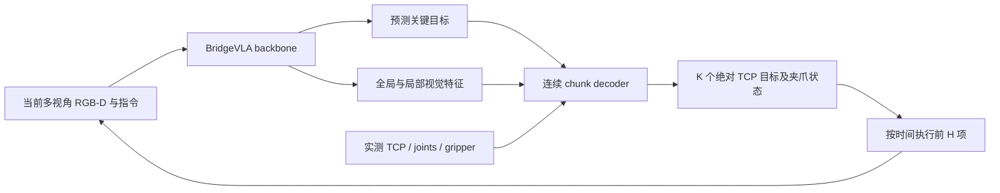

# 关键目标与连续 Action Chunk Baseline

状态：2026-10-23，V4 数据、joint/frozen_key 两种 chunk 训练、checkpoint、离线评估、HTTP 协议与原生客户端前缀执行已接通。默认冻结 Gemma 前 6 层、视觉编码器与 projector，联合训练后续 Gemma 层、关键目标头和 chunk decoder。CPU 合成数据及仿真接口替身用于回归；真实 CUDA 模型和 IsaacLab 闭环待服务器验收。数据及训练命令见 [OHT README](../../finetune/OHT/README.md#v4关键目标--连续-chunk-训练与评估)，服务启动见 [VLA server 指南](../guides/oht-vla-server.md)。

## 1. 首版范围

保留 BridgeVLA 的关键目标定位、旋转和夹爪分支，新增预测连续 TCP 轨迹的 chunk decoder。关键目标提供任务方向；客户端实际执行连续动作块的短前缀，再获取新观测。

首版以现有 OHT 绝对 EEF 模型和数据跑通，但模型不写入 `assemble/disassemble` 的专用阶段、轴孔几何或任务专用控制分支。同一结构之后可接 RLBench 的连续示范。只使用单次请求的多视角观测和实测 proprioception；时间记忆、物体辅助、轨迹修复、动态 horizon、异步物理执行和碰撞规划分别留作后续实验。

与参考代码的对应关系：用户提供的 `play_hvla2_v2_oht.py` 分别读取 `fused_key_action/raw_key_actions` 和 `raw_actions`，前者用于关键目标可视化，后者逐项执行。客户端能证明这个输出分工，不能证明参考模型内部的条件连接或训练损失。本 baseline 明确让 chunk decoder 使用预测关键目标；这是一项自行确定的设计。

## 2. 数据流与动作定义

首版固定 `action_mode=eef`：每个执行目标为 `[x,y,z,qx,qy,qz,qw,open01]`，位置为 world 米，旋转为单位四元数 `xyzw`，参考点为训练记录定义的 TCP，夹爪 `1=open, 0=close`。不在这一版同时扩展四种动作表示。

decoder 内部输出每项 10 维：位置 3、连续旋转表示 6、夹爪 logit 1。旋转经正交化恢复旋转矩阵，再转为单位四元数用于协议；退化旋转、NaN 或非法动作需显式报错。关键目标原有旋转分类保留，连续轨迹不再受其 5 度分桶直接限制。

每个未来目标均相对于固定的 world 坐标系，不是速度，不是相对上一目标的增量，也不是把旧单关键点标签复制 K 份。`K` 是预测长度，`H` 是本次最多执行的长度，满足 `1 <= H <= K`。

建议初始实验为 `K=16, H=4`；这是待验证起点。先做 `K=1,H=1`，再与 `K=16,H=1`、`K=16,H=4` 对照。有效预测时长为 `K * action_dt`，不能脱离实际时间间隔比较 K。

## 3. 连续监督与 replay 契约

### 3.1 从原始轨迹取标签

连续目标来自原始 Parquet 中的实测 TCP、实测关节和滤波后的夹爪状态，沿用已核查的四元数顺序、TCP 偏移和相机处理。PD 数据的原始 `action[:6]` 不作为连续目标；稀疏关键点之间的直线插值也不作为专家路径。

对观测时刻 `t`，第 j 项监督取 `t + (j+1)*action_dt`，第一项严格位于未来。`sample_stride` 只控制训练输入帧密度，不能冒充 action 的时间间隔。

首版采用可验证的等间隔记录帧：显式保存 `action_frame_stride`、实际 `action_dt` 和目标时间戳，构建时检查各 episode 的记录间隔及 stride 后的时间误差。选择 stride 前先统计原始 dt；不能仅因文档写了 60 Hz 就固定为 1/60 秒。存在缺帧或过大时间间隔的窗口不跨越，需跳过并报告。跨采样率重采样另立模式，不在首版静默插值。

夹爪按各目标时间戳对应的实测二值状态监督。构建器报告采样是否丢失了两个目标 tick 之间完整的开闭切换；出现丢失时调整 stride 或剔除对应窗口，不能把事件偷偷提前到前一个 tick。

### 3.2 关键目标监督独立保留

沿用已有关键点提取方法：OHT 对齐旧实验时仍为 `keypoints.method=gripper`；通用任务可显式选择已有 `bridgevla` 的开闭、停稳和终帧方式，并重新构建 cache。首版不另加任务专用的 contact/phase 标签。

每个输入的关键目标仍取严格更晚的下一关键点，可以位于当前 K 步之外。连续轨迹从当前状态出发，不要求 K 步内到达远处关键目标，也不将 chunk 强行截断或拉伸到关键点。

连续样本可保留最后关键点之后的尾段，以及没有夹爪切换但仍有有效未来轨迹的 episode。无未来关键点时 `key_valid=false`，只屏蔽关键目标监督；这个 GT mask 不作为 decoder 的输入，也不用于在线决定是否执行。在线始终使用当前观测预测的关键目标。

### 3.3 新缓存字段

V4 的数据布局已独立实现，不能直接塞进现有单关键点 cache：

| 字段 | 单样本形状 / 含义 |
| --- | --- |
| 当前 RGB-D、标定、指令 | 复用现有观测契约 |
| `tcp_pose` | `[7]`，当前实测 world TCP / xyzw |
| `joint_positions` | `[6]`，当前实测关节角，顺序绑定机器人配置 |
| `gripper_open01` | 当前实测归一化开度，不用未来目标夹爪代替 |
| `key_action` | `[8]`，下一关键目标的监督标签 |
| `key_joint_action` | `[7]`，同一关键目标帧的实测关节/夹爪标签 |
| `key_valid` | 仅用于关键目标损失的有效性 mask |
| `action_chunk` | `[K,8]`，未来实测绝对 EEF / 夹爪标签 |
| `joint_chunk` | `[K,7]`，同一批未来帧的实测关节/夹爪标签；不表示关节 chunk 模型已实施 |
| `action_timestamps` | `[K]`，未来目标的实际时间戳 |
| `action_valid` | `[K]`，每项标签的有效性 mask |

V4 schema 为 `oht_bridgevla_v4`。当前状态与 RGB-D 保存于 observations NPZ，以上目标及 `key_frame/action_frames` 保存在独立 targets NPZ，两个文件均由样本索引绑定哈希。使用完整原始数据重建，不复用 V3 观测；audit 和组划分保持一致。无 key 和 padding 使用固定中性占位，只有 mask 有效项参与后续监督。

episode 尾部只保留至少有一项未来目标的窗口，剩余项 padding 并设置 mask；padding 不参与损失、统计或控制。不越过 episode，不以复制末帧制造停留监督。真实停留段仍保留，不因位移小就删除。

cache contract 绑定原始 audit、坐标定义、关键点方法、K、stride、dt 容差、mask 规则、观测索引和标签索引的摘要。旧 replay 的单关键点标签不足以恢复密集路径，需从原始轨迹生成新的 chunk cache；不能只修改原 `contract.json`。

同一 episode、关联场景及其派生样本保持原来的组划分。位置尺度当前由配置固定为 0.25 m，写入 checkpoint；后续若改为拟合，只用 train。旧关键点策略与 chunk 的直接对照使用相同输入锚点；完整尾段覆盖另报结果，避免把数据覆盖变化误算成架构收益。

## 4. 模型与训练

### 4.1 最小 decoder

使用轻量 Transformer decoder，一次并行预测 K 个动作，不先引入 diffusion、CVAE 或多候选优化。每个时间位置使用一个 query；memory 包括：

- 当前多视角的 coarse 全局视觉特征。
- 以预测关键目标裁剪的 refine 视觉特征。
- 当前实测 TCP、关节角、实测夹爪的 proprio token。
- 预测关键目标的 pose/gripper embedding。

既有 `low_dim_state[4]` 不是完整 proprioception。现有 EEF 路径也不会因为 replay 文件中含有关节角，就自动将其作为网络条件。需要明确添加状态输入，并同步训练、prepared/raw 服务和在线客户端的字段白名单。

关键目标 pose/gripper 对 decoder 使用 detach，不让 chunk loss 通过离散 waypoint/旋转解码及裁剪位置反传。joint 保留预测分支视觉特征的梯度，chunk loss 可更新未冻结的 Gemma 后续层；frozen_key 则全部 detach。若显式冻结完整 VLM，则关键目标头通过 key loss 更新，chunk decoder 通过 chunk loss 更新。decoder 的位置归一化、旋转编码和夹爪二值化在训练、评估和服务中共用同一实现。

### 4.2 GT 裁剪与训练部署一致性

现有 MVT 训练时使用 GT 关键点选择局部区域和局部特征，推理时使用预测点。`oht_action_features` 也包含 waypoint 附近的特征，不能直接将训练输出接到新 decoder 并声称其条件与在线相同。

支持两种可独立选择的训练阶段。`frozen_key` 从已有 EEF checkpoint 加载关键目标网络，将其设为冻结的 inference-equivalent 特征提取器，仅训练新 decoder。每次从当前观测预测关键目标和对应 coarse/refine 特征；预测路径不接收 GT waypoint、GT rotation conditioning 或未来状态。模型的 train/eval 状态分别控制，`key_valid` 不影响该前向路径。

默认 `joint` 增加独立的关键目标监督 forward：先选取 `key_valid=true` 的子批，沿用原 GT 裁剪、旋转 conditioning 与 heatmap/旋转/夹爪损失；之后切换为预测路由，重新从当前观测预测关键目标和 coarse/refine 特征，再送入 chunk decoder。两条路径共享参数，不共享 GT 选出的局部特征。冻结模块保持 eval，BatchNorm 运行统计固定，仿射参数按冻结规则训练；这也允许有效关键目标子批仅含一个样本。两个 forward 均位于同一个外层 DDP forward 内，最后只 backward/step 一次。额外 forward 的算力和显存需单独实测。

### 4.3 损失与训练策略

masked chunk loss 包含位置的归一化 Smooth L1、连续旋转恢复后的旋转矩阵距离、夹爪 BCE。所有项按有效项数量归一化，旋转损失对四元数正负号等价。frozen_key 只优化该损失。首版不加轨迹平滑、直线吸引、强制到达 key endpoint 或未经标注的碰撞损失。

joint 优化 `chunk_loss + key_loss_weight * key_loss`，默认权重 1.0。没有未来关键点的样本仅计算 chunk loss，key loss 按全卡有效关键目标数归一化，允许某个 rank 全部为无 key 尾段。GT 关键目标仅用于独立监督，不进入 chunk 条件。TensorBoard 分别记录 key 和 chunk 的总损失及各分量。

新配置独立继承 `oht_full_8x40.yaml` 的 AdamW、学习率、epoch/global batch、采样、保存频率和 TensorBoard 习惯。默认 joint 沿用父配置的按层数冻结：`freeze_gemma_prefix_layers=6`、`freeze_language_model=false`、`freeze_vision_tower=true`、`freeze_multimodal_projector=true`；Gemma 后续层、关键目标头及 chunk decoder 可训练，`lm_head/embed_tokens` 继续冻结。层数可配置为非负整数；显式 `freeze_language_model=true` 可冻结整个语言模型。frozen_key 则额外冻结整个关键目标网络。可训练参数名单和数量写入日志。

空间增强必须同时变换当前点云、当前 TCP、关键目标和整个 chunk；机器人状态不能因此变成无法用 q 验证的虚构构型。首个 chunk 配置显式关闭全局刚体变换增强，先保留独立的图像增强；恢复空间增强需先定义机器人基座/关节的等变契约，并作为独立实验。

旧单动作 checkpoint 只能初始化兼容权重，新 decoder 需训练。单动作与 chunk 的输出结构、cache 和优化器状态不同，不能用旧 `--resume` 无缝切换；resume 指纹包含 chunk 设置、动作编码、proprio、冻结策略和训练阶段。已有 chunk 在仅阶段/key loss 权重变化时可用 `--init-checkpoint` 保留 encoder/decoder，重新初始化优化器。多 GPU 继续使用现有 DDP/累积/epoch 逻辑，joint 允许动态无监督关键目标头，并检查保存恢复一致性。

## 5. 服务与客户端

### 5.1 独立协商 chunk 协议

保留现有单动作协议，为 chunk 增加明确的 schema；不能在原 `action` 字段里静默返回二维数组。新协议的逻辑字段包括：

| 位置 | 必需信息 |
| --- | --- |
| `/model_info` | chunk schema、K、dt、EEF 坐标/TCP/夹爪定义、proprio 字段和顺序 |
| 请求 | episode、递增请求序号、实测仿真时刻、当前 RGB-D/proprio、指令 |
| 响应 | 原请求身份、预测 `key_action`、`actions[K,8]`、从观测时刻起的目标时间偏移 |
| 客户端 | 固定 `H <= K`、控制器尺度、chunk 缓存和已消费索引 |

响应中的整段预测应有有效、有限的 K 项；训练 padding mask 不授权服务发送未知尾段。episode 终止和运行预算由客户端/任务判据处理，不能使用 GT 剩余长度决定在线输出长度。

请求序号、chunk 内动作索引、底层控制步和仿真时间分开记录。`--max-steps` 的现有含义不能在同一命令下静默改变，新执行模式需明确各预算单位。reset、窗口关闭、HTTP 失败或身份不匹配时清空未执行动作；不执行上一 episode 的尾段。

### 5.2 连续执行语义

一次响应后最多消费前 H 项。每项是对应未来时间的跟踪目标，使用当前实测 TCP 计算 OSC 误差，沿用坐标转换、尺度和物理限幅；到达该项时间预算后推进到下一项，不启动旧的“关键点到位后开闭夹爪”的执行流程。

若 action_dt 大于环境 control dt，用控制子步跟踪相邻目标之间的短段插值：起点为本次实测 TCP，后续为相邻绝对目标，平移线性、姿态沿最短旋转插值；夹爪采用离散时序，不做连续开闭插值。这只是短时间轨迹跟踪，不能拿它替代专家路径或宣称避碰。时间无法整除时需有显式调度误差预算，不逐目标四舍五入造成累计漂移。

消费完成后重新捕获观测，丢弃未消费后缀，并重新预测。夹爪状态随 chunk 的目标 tick 执行；不能把第 16 项的开闭状态提前应用到第 1 项，也不能等待远处 key 到位才执行所有夹爪变化。

默认先保留同步策略查询：等待服务时刷新 GUI、暂停物理时间，响应后从同一个物理状态执行。这便于验证动作语义，不代表满足真实机器人实时要求。需分别报告采集、网络、模型、控制耗时，以及仿真时间和墙钟时间。现有约 0.8 秒级请求不能仅因 `H=4` 就宣称达到连续 20 Hz 闭环；异步执行须另行解决延迟、过期后缀和前缀衔接。

硬关节边界、非法动作和任务终止的检查仍保留。跟踪误差长期过大时丢弃 chunk 并记录明确失败或触发受限重查询，不能反复执行同一个不可达目标。此 baseline 不提供全臂、夹持物和环境的碰撞规划保证；Key-Action、连续 chunk 以及更频繁查询本身均不等于无碰撞轨迹。

## 6. 实施顺序与验收

| 步骤 | 改动位置 | 完成标准 |
| --- | --- | --- |
| 1. 数据契约（已实施，服务器全量构建待运行） | `data/chunk_actions.py`、`data/chunk_replay.py`、`data/chunk_dataset.py`、CLI | V4 构建、严格校验、独立数据读取；CPU 合成 Parquet/视频回归 |
| 2. 训练接口（已接通） | `chunk_model.py`、`model.py`、MVT token 出口 | 独立 GT 关键目标监督与 prediction-only chunk 条件；冻结策略可配置 |
| 3. 连续预测（已接通） | `chunk_config.py`、V4 YAML、`train.py`、`chunk_eval.py` | masked loss、按 offset 评估、共享 epoch/DDP/保存恢复；多卡 CUDA 待实测 |
| 4. 服务协议（已接通） | `runtime/chunk_protocol.py`、policy、raw/prepared、HTTP service/client | 显式 `chunk_spec`，响应返回 `actions` 而不是伪装成单个 `action` |
| 5. 执行器（已接通） | `runtime/chunk_executor.py`、`isaaclab_client.py` | 固定 dt 消费前缀、夹爪时序、跟踪异常停止；真实仿真待验收 |
| 6. 评估与可视化（已接通） | TensorBoard、离线 PNG/NPZ、在线 3D | 关键目标热图、预测 chunk 与默认前缀；客户端日志记录真实执行 |

当前配置为 `configs/oht_chunk_v4_8x40.yaml`，继承 full 8x40 的 AdamW/epoch/logging，默认 joint；可训练参数名单写入 run。K 可以小于等于 cache 的监督 horizon，因此同一 V4 数据可做 K=1 对照。旧关键目标 checkpoint 用 `--init-checkpoint` 初始化 encoder，要求已解析的 data profiles/标定一致；相同阶段及冻结策略的 chunk checkpoint 才可 resume。

当前预测条件按样本复用原部署 `act` 路径，以保持裁剪/旋转推理一致，尚未实现 backbone 批量推理优化。同步网络等待期间暂停物理时间。首版执行器要求 action_dt 为 control dt 的整数倍；不以浮点四舍五入改变动作时间。超出默认 0.10 m / 0.5 rad 跟踪误差或已越过已知硬限位时停止，不无限等待。

joint 和 frozen_key 共用 V4 数据及部署协议。物体辅助、异步执行和避碰规划保持为独立实验；真实多卡 CUDA 的吞吐和显存仍待服务器验证。

数据回归至少覆盖：第一项目标严格未来、无跨 episode、无未来 key 的尾段、真实停留、缺帧窗口、夹爪事件、四元数符号等价和 padding 不参与损失。collate 后显式约定 `[B,1,K,D]` 的 replay 历史轴和未来轴；禁止沿用单动作白名单把 float chunk 标签转成 int。

执行回归至少覆盖：绝对目标不被重复累加、夹爪切换时序、相同前缀的 K/H 消费、旧响应拒绝、reset 清缓存、dt 不匹配、控制尺度和过期后缀。真实 CUDA/IsaacLab 验收包含当前代码版本、配置和相同初始化下的 dense GT、模型 chunk 结果；历史 GT replay 正常不替代本版本验收。

## 7. 对照与报告

| 实验 | 用途 |
| --- | --- |
| 原单关键点策略 + 原执行器 | 保留当前结果和故障基线 |
| 新连续头 K=1、相同 proprio/训练数据 | 区分状态输入和连续旋转的收益 |
| 无关键目标条件的 K=16 chunk | 检验关键目标条件是否有用 |
| 预测关键目标条件的 K=16 chunk | 本文首版目标 |
| GT 关键目标条件的 chunk | 仅诊断上界，单独标为 privileged |

比较关键目标条件时共享视觉路径、proprio、decoder 容量、训练数据和执行器。无 key 条件对照需同时处理预测 key 引导的 refine crop：显式目标 embedding 的消融可保留该 crop；要测“全部 key 条件”的收益，应另做双方共用全局特征/相同裁剪规则的对照，不能把删 embedding 称为完全无 key。不同 H 的结果报告查询次数和墙钟耗时。

离线报告每个未来 offset 的位置/旋转误差、夹爪事件与有效项数，关键目标单独报告，不把 K 步平均误差当闭环成功率。闭环报告任务完成、跟踪误差、限位/碰撞/停滞、夹爪执行、查询次数和耗时。无任务成功判据的运行仍为 smoke，不能输出任务成功率。

先以 OHT 跑通数据到闭环，再迁移至少一类不依赖夹爪切换的任务验证通用性。该版本承担可靠 baseline 的作用；保持任务效果的轨迹调整、物体辅助和更复杂轨迹生成器，在此基础上分别验证。
