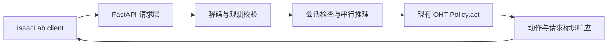

# OHT VLA server 设计

状态：已实现 prepared 和 raw RGB-D 两种观测、四个 FastAPI 接口、串行推理、会话管理、日志、replay 烟测及独立 HTTP IsaacLab 客户端。内置原生工厂启动 AppLauncher 和注册 OHT 环境，接入已有 Camera sensors 或 USD/Replicator 相机，支持四种动作模式及四任务独立的初始化/评分配置；参考脚本只作为可选兼容入口。CPU/HTTP 和控制数学回归可在无 Isaac Sim 环境运行；真实 checkpoint 的 CUDA 前向及 IsaacLab 闭环待在服务器验证。现有 `python -m finetune.OHT.server` 的 `/act` 服务继续使用。运行命令和 raw 契约见 [服务指南](../guides/oht-vla-server.md)。

本文先确定模型服务的组织方式，不讨论选择哪种机器人动作表示，也不把控制器、运动规划或 `env.step()` 放入服务端。

## 1. 服务边界

首版采用一个进程、一个 GPU 模型实例、一个 IsaacLab client。四个子任务通过请求中的 instruction 区分，不按任务文件夹启动四个模型。若确实需要不同 checkpoint，再启动独立进程和端口。



可以参考 H-VLA2 的 FastAPI 外壳、`/health`、`/predict`、启动日志和模型路径参数。模型加载与推理仍调用本仓库的 BridgeVLA 实现；H-VLA2 的 `load_hvla2`、`proprio` 布局、DDIM 参数及融合输出不作为 BridgeVLA 接口契约。

## 2. 复用已有实现

| 现有模块 | 复用职责 |
| --- | --- |
| `finetune/OHT/runtime/loading.py` | 从 checkpoint 读取训练配置和数据契约，构造并加载 Policy |
| `finetune/OHT/runtime/policy.py` | 观测白名单、点云过滤、模型推理和最终输出校验 |
| `finetune/OHT/runtime/transport.py` | typed tensor 的 dtype、shape、Base64 编解码及体积限制 |
| `finetune/OHT/data/observation.py` | 与训练一致的观测构造、标定及形状校验 |
| `finetune/OHT/server.py` | 参考 episode/step/timestamp 检查和失败后重置规则 |

新增 FastAPI 层调用同一个 Policy，不复制网络前向或重新编写点云渲染。baseline、role queries 和 external predictor 均由 checkpoint 配置决定，HTTP handler 不各写一套推理分支。

## 3. 启动与生命周期

入口为 `finetune/OHT/vla_server.py`：

```bash
python -m finetune.OHT.vla_server \
  --model-path /data/oht/runs/baseline-s0 \
  --device cuda:0 \
  --host 0.0.0.0 \
  --port 8010 \
  --output-dir logs/oht_vla_server
```

- `--model-path` 接受 checkpoint 文件或训练 run 目录。目录显式解析为 `model_last.pth`；文件缺失时报错，不通过修改时间猜测 checkpoint。`--checkpoint` 是互斥别名。
- 模型结构、任务所需相机、点云过滤、自定义渲染方向及输出描述从 checkpoint 获取，不再手工传入另一份训练 YAML。
- 保留现有加载器需要的 `--pretrain-path` 和 external predictor 参数，不能照搬 H-VLA2 的 full-checkpoint 加载承诺。基础模型/processor 的缓存与依赖仍按 BridgeVLA 实际加载行为检查。
- 在 FastAPI lifespan 中建立推理运行时、加载模型，成功后再接受推理请求；退出时停止接收新推理，等待正在运行的工作完成并释放资源。[FastAPI lifespan](https://fastapi.tiangolo.com/advanced/events/)
- 加载、可选预热、推理和 reset 在同一条专用工作线程中串行执行。服务进程只创建一个模型实例，首版设置 Uvicorn `workers=1`。多个 workers 是独立进程，不能作为共享同一模型实例的方式。[FastAPI workers](https://fastapi.tiangolo.com/deployment/server-workers/)
- `--warmup-replay` 可指定预热 replay，`--warmup-split` / `--warmup-index` 选择样本。只把策略白名单字段传给模型；预热后 reset，再进入正式 episode。不从 GT 动作/teacher 构造在线输入。

## 4. HTTP 接口

| 接口 | 职责 |
| --- | --- |
| `GET /health` | 轻量查询 ready/busy/error 状态，不触发 GPU 前向 |
| `GET /model_info` | 返回模型标识、API 版本、相机名、观测字段/shape/dtype、数据契约标识及 checkpoint 输出描述 |
| `POST /reset` | 清除当前 episode 的策略/predictor 状态，设置新的 episode 标识 |
| `POST /predict` | 解码、验证当前观测，调用一次 Policy，返回一次模型输出 |

首版不做在线切换 checkpoint。旧 `/act` 与新 `/predict` 是独立入口，需要使用不同进程和端口，不在同一个模型上建立两套状态。

### 请求

采用固定外层结构，保留 H-VLA2 风格的 `instruction`，观测统一收进 `observation`：

```json
{
  "api_version": "bridgevla_predict_v1",
  "request_id": "episode-001-step-0000",
  "episode_id": "episode-001",
  "step": 0,
  "timestamp": 0.0,
  "model_id": "oht-baseline-s0",
  "contract_sha256": "<从 model_info 获取>",
  "instruction": "<实际任务指令>",
  "observation_format": "bridgevla_prepared_v1",
  "observation": {
    "<字段名>": {
      "dtype": "float32",
      "shape": [4],
      "data": "<Base64 编码的原始数组字节>"
    }
  }
}
```

上例的 observation 仅展示数组封装，实际请求必须包含 `/model_info` 声明的全部字段。

prepared 格式继续支持：client 提供与训练缓存一致的 CHW RGB、metric depth、world XYZ、相机 K/T 和状态。字段和尺寸完全读取 checkpoint 契约，不把五相机数量或图像尺寸写死。

raw RGB-D 格式 `bridgevla_rgbd_v1` 已加入：接收 HWC RGB、米制 Z-depth、实时 K、OpenGL camera→world xyz+wxyz、实测 joint6/EE link/夹爪，以及显式 task/data_profile。服务端统一反投影、整数采样、光学坐标转换、TCP offset 和因果夹爪状态。raw 历史在推理成功后提交，reset 清空；episode 内不能切换 task/profile/format。两种格式不根据数组大小猜测单位或外参方向。无像素对应关系的稀疏点云不能等同于当前组织化 XYZ。

参考服务使用的 `json_numpy` 若需要保留，作为单独、明确启用的兼容解码器实现；仅转换已知字段。不能为了接收旧请求，复制缺失相机、补虚构深度，或把 H-VLA2 的 `proprio` 自动解释成 BridgeVLA 状态。兼容层的字段映射可在取得真实 client 后补齐。

### 响应

```json
{
  "api_version": "bridgevla_predict_v1",
  "request_id": "episode-001-step-0000",
  "episode_id": "episode-001",
  "step": 0,
  "timestamp": 0.0,
  "model_id": "oht-baseline-s0",
  "contract_sha256": "<模型绑定的数据契约>",
  "action": [0.0],
  "action_spec": {},
  "timing_ms": {
    "decode": 0.0,
    "prepare": 0.0,
    "policy": 0.0,
    "total": 0.0
  }
}
```

上例 action 数值和描述仅为结构占位，实际长度和语义由 checkpoint 输出决定。server 返回模型结果，client 负责执行。

不伪造 H-VLA2 的 `normalized_actions`、`fused_key_action`、置信度或生成文本。若需返回 `raw_actions` 别名，需先明确旧 client 期望一维动作还是动作序列，再在兼容层转换。首版默认不输出大型热图/点云；模型已提供的诊断可通过单独开关按频率保存。

## 5. 并发、会话与错误

`async def` 不会自动把普通模型调用转移到后台线程。GPU 推理、数组解码和预处理交给专用工作线程，事件循环负责网络读写与轻量健康查询。[FastAPI 同步函数调用说明](https://fastapi.tiangolo.com/async/#other-utility-functions)

首版只允许一个正在处理的推理请求，不积压控制请求；忙时直接返回 429。reset 与 predict 使用同一个准入控制，推理未结束时不并发修改策略状态。body 在解码前按实际接收字节数限额，解码后继续校验 dtype/shape/体积；无效点的 NaN 按已有数据契约处理。

会话规则：

- 新 episode 从 step 0 开始，清除模型和外部 predictor 状态。
- 同一 episode 的 step 和测量时间戳严格递增，instruction 固定；不同任务通过新 episode 切换。
- 并发客户端或交错 episode 返回明确冲突，不把不同仿真环境的状态混合。
- 首版拒绝重复 request_id/step，客户端不自动重试控制请求。后续若需要幂等缓存，必须校验相同请求内容并限制缓存大小，不能对重试重新执行模型。
- 网络超时或断连不代表后台 CUDA 工作已取消。工作完成前保留 busy；状态推进或失败标记在工作线程完成，不因 HTTP 协程退出而丢失。结果不确定时使用新 episode/reset，不放行同一步的重试。
- 推理内部异常后将 episode 标为失败，待 reset；输入校验失败不推进 step。

接口区分输入错误（400/422）、会话冲突（409）、忙（429）、未就绪（503）和推理失败（500）。体积超限返回 413，非 JSON Content-Type 返回 415。最近 4096 个已执行请求 ID 用于去重；step/episode 检查独立于该窗口。首次 predict 可以从 step 0 自动建立 episode，此后切换 episode 必须显式 reset 并使用未使用过的 episode ID。

多环境并发和 batch 推理另行设计。即使模型本身暂时无历史记忆，也不能忽略外部 predictor/reset 的会话状态。

## 6. 日志与文件组织

启动时写入 `info.json`：checkpoint 路径、模型/API 标识、数据契约、相机列表、渲染方向、设备、启动时间、依赖版本。逐请求 JSONL 记录 request/episode/step、状态、输出摘要和分段耗时；采用日志轮转。默认不保存完整 RGB-D 或点云。

`policy` 耗时先定义为包含设备结果回传的墙钟耗时；若另提供 GPU kernel 耗时，明确使用 CUDA events，避免用异步提交时长冒充前向执行时长。

实现文件：

```text
finetune/OHT/
  vla_server.py                 # CLI、FastAPI app/lifespan、路由
  isaaclab_client.py            # 原生 runtime factory / 兼容入口与 rollout
  runtime/
    inference_service.py        # 单工作线程、会话、准入与模型元信息
    inference_api.py            # 请求/响应结构和错误分类
    observation_adapter.py      # prepared 解码
    raw_observation.py          # metric RGB-D → 训练一致的观测
    http_client.py              # 严格会话校验；控制请求不重试
    isaaclab_runtime.py         # 已有 env / Camera sensors 适配
    isaaclab_factory.py         # 内置 AppLauncher、注册环境和相机绑定
    usd_cameras.py              # USD/Replicator RGB-D；物理 body 驱动 wrist pose
    isaaclab_bridge.py          # 实测状态、固定目标、OSC 跟踪
    joint_executor.py           # 关节顺序、scale/offset 与位置执行
    task_runtime.py             # 四任务独立初始化/评分接口
  requirements-server.txt      # FastAPI、Uvicorn；测试使用 httpx
  vla_server.sh                # 环境配置、模型检查、启动信息和参数透传
  serve.sh                     # 兼容入口，调用 vla_server.sh
tests/
  test_oht_vla_server.py
  test_oht_server_launcher.py
  test_oht_isaaclab_http.py
  test_oht_native_runtime.py
  test_oht_standalone_client.py
tools/
  oht_bridgevla_client.py       # 可在 IsaacLab 根目录运行/复制的独立启动文件
  smoke_oht_vla_server.py       # 真实 replay → HTTP；不执行返回动作
```

依赖单独列出，数据处理工具无需安装 Web 服务依赖。已有 loading/Policy/transport 保持为实际模型能力的唯一实现。

## 7. 实施顺序与验收

1. 已实现 FastAPI app factory、lifespan、加载器注入和四个 HTTP 接口；首版接 prepared 观测，复用现有 Policy。
2. 已实现单工作线程准入和严格会话状态，predict/reset 不交错，health 在推理期间仍可查询。
3. 已加入 run 目录解析、元信息、错误分类、耗时日志和 shell 启动入口。
4. 已加入 fake Policy 测试，覆盖只加载一次、HTTP 编解码、错误状态、取消请求后保持 busy、并发拒绝、reset 和退出等待。
5. 已加入合成 replay + CPU 小模型测试，覆盖全部四种动作头及三种物体辅助模式的新接口与直接 Policy 调用一致性；真实 Uvicorn HTTP 测试验证 replay 烟测工具。
6. 待在服务器用真实 checkpoint 和 replay 观测做 CUDA 烟测，确认点云渲染、对象辅助、输出形状与延迟。
7. 已接入原生/兼容 IsaacLab client 的 RGB-D 字段映射、固定目标解码、OSC/关节位置执行及任务评分接口；待在实际 OHT 工程配置场景工厂、成功条件并验收闭环。

首版完成标准是模型加载一次、请求能独立测试、观测与训练一致、推理和 reset 串行、响应可追踪、旧 `/act` 路径不受影响。真实 IsaacLab 闭环成绩作为后续验收单独记录。
