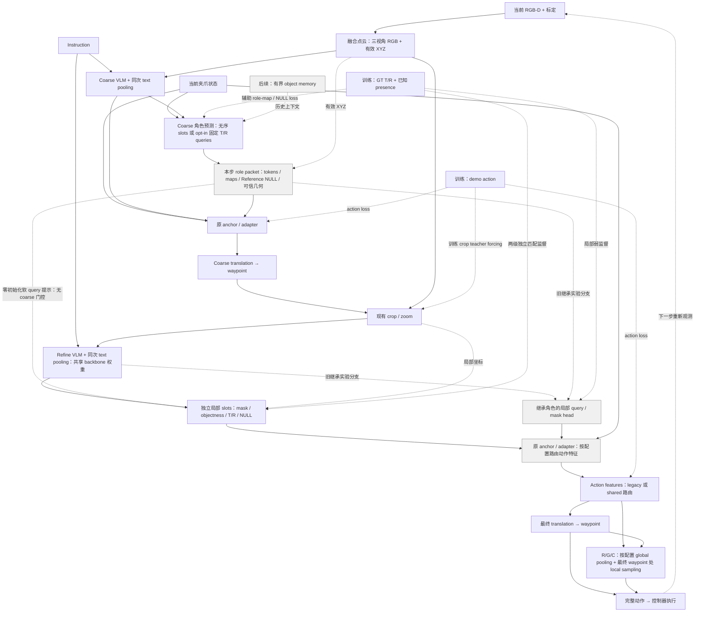

# Object-centric Policy：整体设计与实现契约

[文档索引](../README.md) · [论文 survey](../research/object-centric-policy-memory.md) · [实验与命令](../guides/object-conditioning.md#gt-联合对照) · [代码索引](../reference/code-map.md)

> 代码核对：2026-10-29。本文维护 RLBench O2 的设计与接口，并集中记录基于 OHT 已完成工作的研究动机。OHT 已实现模型与执行契约分别见[训练与模型](../oht/training.md)、[部署与回放](../oht/runtime.md)；下列候选方向是研究假设，未新增运行配置或模型能力。

阅读导航：[研究动机与方向](#研究动机与候选方向) → [架构](#整体架构) → [当前实现与数据](#当前实现与数据契约) → [角色方案](#角色预测与跨尺度调整) → [实验](#实验顺序)；后续查[Memory](#object-centric-memory后续未实现)、[真机部署](#真实机器人部署后续规划)、[投影扩展](#其他可选扩展未实现)。

## 研究动机与候选方向

更新：2026-10-29。这里回答现有结果支持什么研究问题；具体命令、损失和协议仍由 OHT 三份文档维护。

### 从现有工作得到的出发点

| 已有基础 | 可以支持的判断 | 尚待证明 |
| --- | --- | --- |
| `regression_state` 整体配置获用户轨迹解决确认 | 已有可继续研究的短期动作基线 | 尚无完整 run/checkpoint/定量报告，也未独立证明 q6、AdaLN、key gate 各自的贡献 |
| O2 已有 T/R 预测、NULL/unknown 区分、soft-coarse 与局部 refine 对照 | 已有研究任务角色与局部几何的实现入口 | 尚未证明这些分支改善 OHT 连续轨迹；V4 chunk 当前仍只支持 baseline+EEF，不消费 role packet |
| chunk 使用实测 TCP/q6/开度、预测 key 及 coarse/refine 特征 | 可以拆开诊断状态、目标和视觉的信息作用 | key gate 仅控制显式条件，refine crop 仍受预测 key 影响；开口稳定不等于抓取/装配成功 |
| 已有 K/dt/H 协商、GT 回放与执行诊断 | 可以区分预测误差、跟踪误差及时间预算 | 当前 HTTP 等待暂停物理，CPU 回归和离线误差不提供真实实时/闭环成功率证据 |

核心 motivation：**任务角色决定操作哪个实体及其关系，当前状态决定下一小段动作能怎样执行；研究二者如何共同约束连续轨迹，并在目标或几何证据不可靠时及时纠正条件。**

推荐主线是角色条件的状态回归轨迹；最先做的低成本工作是 key/crop 诊断与基线归档。下列收益均是待检验假设，模块组合本身不构成新颖性结论。

### 方向一：角色条件的连续轨迹（优先主线）

**动机。** 当前 TCP 相对参数化解决动作坐标组织，T/R 则表达任务中的物体关系。两条工作尚未在 V4 chunk 接通，适合检验对象/Reference 位移或局部可见性变化时，角色证据是否提供额外任务信息。

**最小方案。** 保持现有 regression、完整场景特征和实测状态，新增当前观测预测的 T/R tokens、TCP 系下相对几何、Reference NULL 与独立 geometry-valid 条件。先使用可靠中心/相对位移与可见支持，不把局部点云中心/spread 当作完整物体位姿或插接轴。V4 需显式增加可选、哈希绑定的 teacher/预测接口；单改 YAML 的 `mode` 无法启用。

**关键对照。** 无角色基线、仅角色辅助监督、预测角色条件、等容量普通视觉 tokens；GT-role 只作 privileged 诊断。固定数据/初始化/解冻范围/预算与执行器，在物理有效的留出物体位置、Reference 位置和遮挡条件下比较前缀误差与完整 case 闭环，而非只看 mask loss。角色打乱用于检查条件依赖；推理时删除输入不能替代重新训练的消融。

**否定条件。** 若可靠 GT 角色也无增益，先停止扩大角色预测器；若普通 tokens 或仅辅助监督达到同样效果，不将收益独占归因于角色条件。已有 [3D Diffuser Actor](https://arxiv.org/abs/2402.10885v3) 融合三维场景/语言/本体状态，[EquiBot](https://arxiv.org/abs/2407.01479)研究等变策略；本方向仍需对照对象条件策略，当前局部坐标变换不提供整个 VLM 的等变保证。

### 方向二：预测关键目标的可靠使用（先做诊断）

**动机。** 预测 key 可在 K 步窗口之外，并同时控制显式 goal 条件和 refine crop。错误可能从两条路径进入动作，当前的可学习 key gate 没有共同控制这两条路径，也不是逐样本校准的目标置信度。

**第一步。** 在有合法 key 标签的固定离线观测上，做显式 key × crop key 的 predicted/GT 2×2；单列 no-key 尾段。仅替换显式 key 时固定视觉特征；只替换 crop 时固定显式条件并重新提取对应视觉特征。GT 条件仅作诊断，不能将示范的未来 key 无条件用作偏离轨迹后的在线目标。

当前 `ChunkAgent._context()` 将预测 key 与对应裁剪特征绑定，尚无现成 CLI/YAML 开关执行该 2×2；需新增仅离线使用的独立条件注入接口。

**条件成立后再设计。** 若 oracle crop 的收益明显，研究裁剪范围、多候选或全局回退；若主要是显式目标误差，研究经留出集验证的目标可靠性条件。共同处理语义目标与局部支持的有效性，保留当前场景证据。热图峰值或 gate 数值不直接当成已校准错误概率；去显式 key 但保留 key-crop 仍不是完全无 key 对照。

**否定条件。** 若两条 oracle 路径均无稳定收益，就降低 key 可靠性方向的优先级。[ChainedDiffuser](https://proceedings.mlr.press/v229/xian23a.html)已有关键位姿连接局部轨迹，[HAMSTER](https://arxiv.org/abs/2502.05485v4)已有高层路径指导三维控制；可研究的是本接口的错误传播与可纠正性，不能只将分层结构当新贡献。

### 方向三：因果短时上下文与过期证据（条件性扩展）

**动机。** 同一当前姿态可能对应仍在推进、夹爪过渡或先前操作后的不同状态。先收集当前观测近似而正确动作确实不同的案例，确认历史信息缺失，而非先假定需要 object memory。

**最小方案。** 先比较最近观测、严格因果的 TCP/q6/夹爪历史及真实 Δt，再比较同预算 scene/context 历史；有可信关联后才试对象 token bank，按下文[读写与失效契约](#最小-memory先-token后空间缓存)区分身份与过期几何。当前 proprio 没有力/触觉，不能把开度变化直接标为接触成功。使用历史目标/执行残差时，训练也须取得相同来源，示范未来目标不能冒充已执行的 policy 命令。

**否定条件。** 当前观测足够、普通历史效果相同或错误历史抵消收益时，不主张对象 bank 必要。结果验证/恢复还需真实失败和关系标签，成功 demo 的 release 事件不足以监督。通用历史检索/融合已有 [MemoryVLA](https://arxiv.org/abs/2508.19236) 等先例；本项目可检验的是角色切换和几何过期时的使用/失效规则。

### 方向四：执行前缀与延迟预算（部署副线）

先固定 K=16、数据 dt 和物理/墙钟预算，比较 H=1/4/8 的成功率、请求数与耗时；只有确有纠偏收益，再研究按在线跟踪证据选择 H。失败阈值仍保留，历史跟踪误差不保证将来可行或无碰撞。

自适应 horizon 已有 [MoH（ICML 2026）](https://proceedings.mlr.press/v306/jing26f.html)，后果一致性选前缀也有 [CA³C（2026 预印本）](https://arxiv.org/abs/2610.07949)；异步生成/衔接已有 [RTC](https://arxiv.org/abs/2506.07339)。RTC 的 diffusion/flow inpainting 不能直接当作当前确定性回归头已有能力。这里先验证当前系统的成本收益，不将“动态 H”单独当作创新，也不把暂停物理的同步测试称为真实实时控制。

### 第一轮实验与结论门槛

| 顺序 | 工作 | 决策依据 |
| --- | --- | --- |
| 0 | 归档成功 run/固定权重、解析配置与 case 清单；复核数据划分 | 先建立可复核的用户确认基线，不为已存在配置补写成功率 |
| 1 | 同初态 dense GT、GT keypoints、policy；检查 TCP/物体/关节限制和实际跟踪 | 若标定/执行链路有问题，先修其问题；GT keypoints 不作 chunk 定时对照 |
| 2 | key/crop 2×2、状态/视觉重训练消融，保留坐标恢复必需的 TCP | 去 decoder 视觉后仍可能经 key 获得视觉信息，不能据此称纯本体基线 |
| 3 | 角色条件与普通 tokens/辅助监督对照，在物体/Reference 变化的留出集评估 | 有可靠角色增益才扩预测器；若 key 错误主导，先做方向二 |
| 4 | 固定 H 的成本收益，再决定短历史与自适应执行 | 避免在一次实验同时改角色、decoder、memory、controller 和预算 |

正式比较至少 3 个训练 seeds，固定预定 cases 并报告配对差值/95% CI。模型失败和超时保留分母，环境异常单列；原生 OHT CLI 的 attempted 分母与未尝试 cases 按[执行说明](../oht/runtime.md#时间预算与停止结果)重新验收。目标是证明特定信息在特定失效条件下有增量价值，文献筛查和这些实验尚不支持“首次提出”或预期性能数字。相关工作边界集中见[调研补充](../research/object-centric-policy-memory.md#9-oht-连续轨迹与执行的相关工作边界)。

## 整体架构

以下架构、实现状态与既有实验矩阵针对 RLBench O2；上节的 OHT 角色条件 chunk 仍为待实现、待验证方向。

保留 BridgeVLA 的 coarse/refine、每级三视角、共享 VLM 权重和 translation heatmap。
当前优先验证：**以旧无序 slots 为基线，coarse 提供软语义提示，refine 独立预测局部对象。** 硬角色继承与热图残差保留为实验分支，不再作为默认有效的前提；完整动作共享特征仍是独立对照。



每步仍是现有两次 VLM 前向（`3 × 2` 视角），text context 来自同次 hidden states。
预测模式的 GT 只进入辅助监督；推理 crop 来自 coarse waypoint。`internal_slots_soft_coarse` 保留独立局部选择，不输送 coarse 的 valid、几何或热图；旧 cross-scale/refine 配置仍保留硬继承、局部读出及投影残差用于消融。该最小新配置沿用旧动作路由，不同时开启 shared-action/context 改动。

本步继承不是跨步锁定：下一控制步重新选择。完整场景特征始终进入动作分支，T/R maps 不把 waypoint 限制在物体表面。
角色与坐标接口见下文[跨尺度继承](#跨尺度角色继承计划未实现)，函数见[代码索引](../reference/code-map.md)。

## 实现状态

| 状态 | 内容 |
| --- | --- |
| 已实现，闭环待验证 | `soft_coarse_queries`：旧无序 slots 的局部 decoder 接收零初始化软提示，两级独立预测与监督，不继承 coarse 有效性或 NULL 决策 |
| 已实现，默认关闭 | `shared_action_features`：translation 与 R/G/C 使用同一最终特征；`use_context`：同次 VLM 的 instruction 条件 |
| 已实现，预测路线 | 默认无序 slots → soft T/R；opt-in 固定 T/R queries → 直接角色 maps/tokens；两者均预测 Reference NULL、隔离 GT teacher |
| 已实现，数据兼容 | 从旧 replay 的角色 `kind` 只读派生 presence/known；NULL loss 监督实际 posterior |
| 已实现，三个独立开关 | 混合 role-map 监督、coarse→refine 角色继承、几何 unknown 时保留可信 token；默认关闭 |
| 已实现，结构对照 | `object_slots.predictor_type: role_queries`：两个有序角色 queries，默认仍为 `slots`；闭环收益待验证 |
| 已实现，闭环待验证 | `refine_role_masks`：局部读出；`refine_local_query`：coarse-conditioned cross-attention + 投影/几何偏置，更新 tokens/maps 后复用 anchor/action |
| 后续可选 | temporal memory、可信历史点、渲染改进；各自单独验收 |

当前普通 internal-slot 配置为 **2 个无序 slots**，joint/cross-scale 为 **6 个**；`role_queries` 与当前 `internal_slots_refine` 使用两个固定 T/R 语义 queries。
旧配置两级独立预测；`internal_slots_cross_scale` 和 `role_queries` 显式启用本步继承，不自动改变旧配置。
旧配置保留旧动作路由；冻结范围见[训练设置](#训练设置)。只有显式选择新 YAML/开关才会切换结构或路由。

## 当前实现与数据契约

### 核心定义

| 概念 | 定义与边界 |
| --- | --- |
| Target / Reference | 当前操作的任务角色，可随动作与观测切换；固定角色 query 不代表固定物体 ID |
| Reference NULL | 语义上没有 Reference；物体存在但几何不可用是 unknown，不是 NULL |
| 可信几何 | 当前可见点的中心/spread；spread 不是完整物体尺寸 |
| `current_state[B,3]` | gripper open + 两维 finger state；不是 phase GT，也不含当前 EE pose |
| 操作上下文 `z` | 原 anchor query 学到的动作条件，不要求显式 relation/phase 标签 |
| Action anchor | heatmap 解码的 waypoint，可在 T、R、接触点或自由空间，不能反向定义角色 GT |

### Feature 路由

`OracleRelationAnchorFeatureAdapter.forward_with_anchor()` 返回
`translation_features, shared_features, anchor`：

| 路由 | Translation | R/G/C local | R/G/C global |
| --- | --- | --- | --- |
| 默认旧模式 | anchor-enhanced feature | 旧 shared feature | 原始 feature |
| 新共享模式 | anchor-enhanced feature | 同一最终 feature | 从同一最终 feature 重新池化 |
| base diagnostic | 原始特征的独立对照 | 原始 feature | 原始 feature |

推理先解码最终 translation，再在最终 waypoint 处采样 R/G/C；不恢复 post-hoc fusion。
仅切换 shared flag 的 GT 对照不改变角色机制；internal-slot 新共享模式才启用 soft role conditioning。

### Semantic roles 与 action anchor

T/R 是任务角色，heatmap waypoint 是动作锚点，可在物体、接触点或自由空间，不能反向定义角色 GT。
纯诊断报告 `base` 与实际执行的 `final` waypoint，不覆盖 policy 输入；`phase=-1` 干扰对象不能成为有效语义 Target。

可选两次前向模式使 simulator residual 跟随 `trans_base` 的 Target，并使用 gripper 周期锁定；这是预测条件，不是 Oracle GT。
字段与命令见[测试期归因](../guides/object-conditioning.md#测试期-heatmap-action-anchor-归因)。

### Instruction 与当前状态

`pool_instruction_context()` 池化同次 VLM 的非图像有效 tokens，排除特殊 tokens，兼容左右 padding。
`current_state[B,3]` 是 gripper open + 两维 finger state。
旧 `oracle_relation_state` / `relation_state` 名称兼容，但不能与新名称同时传入。

目标 `gripper_pose` 仅用于动作监督，不能替代当前 proprioception；当前接口没有 EE pose 或时间进度。

### Soft geometry

`soft_role_geometry()` 使用本 stage 有效 rendered XYZ 和 role maps，计算可微加权中心与标准差 spread：

- 屏蔽背景、非有限 XYZ 与不可用角色；hard top-k 点用于兼容/可视化与 opt-in 继承的局部提示，不是唯一条件路径。
- spread 描述可见支持，不是完整物体 bbox/size。
- coarse/refine 使用各自坐标系，不混用几何。
- 新模式下 Reference 不可靠不连带关闭有效 Target；geometry unknown 与语义 NULL 分开。

没有历史或新观测，该分支不能可靠定位全遮挡物体。
默认 anchor 仍用 geometry valid 屏蔽 token。开启 `preserve_role_tokens` 后使用独立的角色可靠性，
局部支持消失只关闭空间条件；不构成历史 memory，也不伪造遮挡期间的位姿。

### Teacher 与数据

Schema 入口为 `dataset.py::create_replay()`，loader 为 `utils/get_dataset.py::get_dataset()`；
完整路径见[代码索引](../reference/code-map.md#semantic-gt-数据流)。

| 字段 | 含义 | 监督规则 |
| --- | --- | --- |
| `oracle_target_present` / `oracle_reference_present` | 语义角色是否定义 | 从已有 `kind` 只读派生：object/site 存在，Reference none 为 absence |
| `oracle_role_present_known[2]` | presence 标签是否可靠 | 无审计或终止占位时为 false |
| `oracle_object_valid` | 当前几何监督可用 | 不等价于 presence；不可用不监督为 NULL |
| visibility | 真正可见性 | 当前不提供独立标签/head |

`_derive_role_presence()` 不改写 replay；Target none 的终止占位不参与角色监督。
预测模式的 GT maps/valid/points 在 `mvt_single.MVT` policy 入口隔离，teacher maps 仅作辅助 loss；
presence 只在 `RVTAgent._object_slot_auxiliary_losses()` 使用。NULL loss 监督推理实际 posterior。

当前 replay 只标已选 T/R，不是全实例发现/跟踪数据。可见支持可训练 objectness 正例，但不能称其为语义存在概率。
GT site 体积、点投影 prior 与当前可见实例轮廓不同，role-map 指标必须按监督定义解释。
当前 teacher 经点投影、Gaussian blur 和峰值归一化生成，未与虚拟视角的深度遮挡逐点核验；它监督角色空间 prior，不能当作严格实例分割 GT。
有效 replay、点云与 manifest 无需重写。

<a id="本轮设计未实现"></a>

## 角色预测与跨尺度调整

### 独立 slots + 软 coarse query（当前优先对照）

`rlbench_o2_internal_slots_soft_coarse.yaml` 只在旧无序 slots 的 refine decoder 前增加 `SoftCoarseQueryConditioner`：

\[
Z=\mathrm{LN}([z_T^c,z_R^c])+E_{T/R},\quad
A=\mathrm{softmax}(W_q\mathrm{LN}(Q_f)(W_kZ)^T/\sqrt d),
\]
\[
Q'_f=Q_f+W_o\big[A\,\mathrm{diag}(1,1-p^c_{NULL})W_vZ\big],\qquad
M_f=\sigma(D(F_f,Q'_f)).
\]

`W_o` 的权重/bias 零初始化，替代标量门控，避免两层同时零初始化造成死梯度。加载旧 slots 权重时初始局部输出与旧模型一致；输出投影先学习，打开后 action/auxiliary loss 可回传 coarse soft tokens 与 NULL posterior。

- coarse role tokens 来自 soft role mixing，不乘 coarse valid；不传几何、mask、置信度或 top-k 点。
- refine 仍保留独立 slots、objectness、T/R 和 NULL head；两级使用现有匹配/辅助监督。局部决策不被 coarse invalid/NULL 强制关闭，也不承诺绝不切换对象。
- Reference non-NULL 仅软加权提示值；局部 NULL 自行预测。crop 外 Reference 仍是需要评估的 unknown/absence 区分问题，不声称已解决。
- 不增加 VLM 前向、投影残差或局部 dense mask head。新配置沿用旧 action/context 路由及 objectness 阈值 0.25，与固定角色图峰值门控不同。
- 新参数位于 `object_slot_predictor2.soft_coarse_conditioner`；开关默认 False。旧 slots checkpoint 用 init 保留两级 predictor/adapter，新参数零初始化；不能跨结构恢复 optimizer。

先比较旧配置、同预算新配置及关闭该开关的对照。记录每级 confidence/valid rate、GT 有效样本上的角色覆盖、waypoint 误差和闭环成功率；热图变亮不等于动作改善。实现不保证性能提升。

### 原有跨尺度实验开关

以下三个开关位于 `object_conditioning`，均默认 `False`，只用于内部预测；role-query 配置只启用后两项，角色图采用自身直接监督：

| 开关 | 实现行为 |
| --- | --- |
| `supervise_mixed_role_maps` | 概率空间 BCE/Dice 监督实际混合 T/R maps；保留原 slot loss |
| `inherit_coarse_roles` | refine 跳过 slot selector，继承 tokens/NULL/变换后的几何；预测点只作局部重投影提示 |
| `preserve_role_tokens` | token 与局部 geometry valid 解耦；可信 Target 还可启用全局 anchor 条件 |

继承要求 coarse/refine、shared action features、anchor 和 XYZ correlation channels；token 保留要求 shared + anchor。
继承不依赖 token 保留开关，但只开继承仍可能屏蔽 crop 外 token，需单独消融。
实现与训练命令见[操作指南](../guides/object-conditioning.md#角色一致性开关)。

<a id="最小角色预测计划未实现"></a>

### 角色预测：无序 slots 与固定 T/R queries

**无序 slots 路线。** `InternalObjectSlotPredictor.forward()` 用无序 queries 提取 masks，再经 objectness/role 分数混合成 T/R。
`hungarian_role_slot_losses()` 按总代价做一对一匹配，没有 IoU/代价拒配阈值。
BCE/Dice、role CE 与 objectness 正例原本只监督匹配 slots，未匹配 slots 仍没有对象负例。

**已实现监督对齐。** 开启 `supervise_mixed_role_maps`，使用同 stage GT maps、有效性和已知 presence；
`role_supervision_mask()` 统一 replay 几何有效性、当前 stage 支持、已知 presence 与有限非空 teacher views。
该 mask 同时用于 mixed-map loss 和原匹配 loss 的代价/梯度：空 view 不监督为空图；整角色无支持时不匹配 slot、不产生 objectness 正例。absence 仍只监督 NULL posterior。
关闭继承时两级监督；开启继承时仅 coarse 是学习式角色预测，refine 的离散提示不重复计算角色 loss。

**已实现的两-query 结构对照（收益待验）。** `object_slots.predictor_type: role_queries` 复用三视角特征、query decoder、原 anchor 与同次 instruction/current-state 条件：

```text
q_T / q_R + instruction + 当前状态
  → cross-attention 到 coarse 三视角特征
  → h_T / h_R、M_T / M_R、p(NULL_R)
  → 本步 packet → refine / anchor → 完整动作
```

固定的是 T/R **角色顺序**，不是物体 ID。每个 query 直接输出对应 mask/token；Reference 单独预测 NULL posterior。
参考角色图为 `M_R=(1-p_{NULL})\,\sigma(L_R)`；Reference token 在 anchor 的条件分支应用非 NULL mass，二者属于不同空间/语义路径。
它移除无序匹配、role 分类、slot objectness 和无序 slot cosine diversity，增加针对 T/R 可见表面的分离监督，不引入第三次 VLM 前向；仍保留完整场景特征。
输出 `confidence` 仅为角色图峰值支持分数，不是校准的对象身份、存在或可见性概率。两个 queries 仍可能混淆同类实例，不能称为全实例发现。

损失为 `L_action + λ_map(L_T + L_R) + λ_null L_NULL + λ_sep L_sep`；启用 refine mask head 时再加入 `λ_refine L_refine + λ_refine_sep L_refine_sep`。`λ_map` 复用 `rvt.object_slot_mask_loss_weight`，本模式不叠加 `supervise_mixed_role_maps`：

- maps 使用 BCE/Dice 和有效 GT role maps；NULL 只用可靠 absence 标签。
- 分离项在 GT 投影与当前 rendered XYZ 一致的表面点上，惩罚另一已知角色的响应；来源角色需可见，另一角色可以遮挡或位于 crop 外，但必须保留有效全局角色标注。不把 unknown/NULL、重叠 footprint 或未知背景当成负例。分别由 `rvt.object_slot_diversity_loss_weight` / `rvt.object_refine_diversity_loss_weight` 控制，当前 role-query/refine 配置为 0.01。可见性只是采样几何近似；角色允许共享同一对象不同区域时需关闭分离项或明确互斥标注。日志同时报告参与监督的像素数，详见[配置与边界](../guides/object-conditioning.md#tr-分离监督与日志)。
- Reference token 由角色 query 产生；NULL mass 在 anchor 的语义条件分支只应用一次。
- 没有可靠 Target absence 标签时不新增 Target NULL head；终止占位不参与角色 loss。
- 复用 text pooling、soft geometry 与共享动作路由，保留 action 到 queries/maps/anchor 的梯度。

新结构由独立 [role-query 配置](../../finetune/RLBench/configs/rlbench_o2_role_queries.yaml)及当前 refine 配置启用，其余 slots 配置不变；checkpoint 记录 predictor type。
从 slots 切换时用 `--init_checkpoint`，联合重置 predictor 与 adapter、沿用兼容 backbone/action 权重，不沿用旧 optimizer resume。
对象 slots、relation/role queries、轻量适配和状态 attention 已有论文先例，监督与梯度路径各不相同。新颖性边界与论文依据统一见[调研](../research/object-centric-policy-memory.md#7-motivation-与创新主张)；本项目检验同一步 coarse/refine 的角色绑定与语义/局部几何分离，不预设性能改善。

<a id="跨尺度角色继承计划未实现"></a>

### 跨尺度角色继承（opt-in 已实现）

默认两级独立调用 slot predictor；开启硬继承后 **coarse 本步绑定一次角色，refine 不重选角色；下一控制步重新选择**。只开继承时使用离散提示；启用局部 head 后可更新 token 与 mask，但仍不运行新的 role/NULL selector。以下为保留的硬继承实验，不适用于 `soft_coarse_queries`。
不依赖 temporal memory，不增加 VLM 前向、pair search 或 phase head。

#### 本步接口与条件路径

| `role_packet` 字段 | 用途 |
| --- | --- |
| `role_tokens[B,2,D]` | T/R 与任务上下文；不是纯身份特征 |
| `null_probability[B]` | 继承 coarse Reference posterior，不在 refine 重算 |
| `centers/spreads`、`geometry_valid` | 可见几何，经实际 crop 变换提供关系上下文 |
| 可选 `role_weights[B,2,K]` / `role_confidence[B,2]` | slots 对照与诊断；不当作校准正确率 |
| 可选 `points`、`frame` | 本步可靠点与坐标系；仅作重投影提示 |

packet 不含 GT 点、presence 或目标动作；Reference NULL 只应用一次。
anchor 分开读取全局角色条件与局部空间支持；同时开启 token 保留时，**局部 valid 不清空可信全局 token**。
所有动作仍使用同一最终特征，waypoint 不被角色 mask 强制裁到物体表面。

首版继承 tokens/NULL/可信几何，并重投影 coarse 预测点提示。逐点/视角要求当前 rendered XYZ 对应，
容差为 unit-cube 三个像素 pitch；背景、越界或被其他表面覆盖不作为本角色支持。量化容差不保证身份正确。
继承或 direct role-query 模式的 XYZ 使用干净的实际 crop 坐标，不受 `norm_corr` 或 RGB augmentation 污染；即使关闭继承做 direct-query 消融也保留此坐标契约。VLM RGB 路径不变。
`internal_slots_refine` 以两个固定 T/R queries 为 coarse 条件，关闭无序匹配和额外 mixed-map，保留可见表面 T/R 分离项，再增加 `RoleConditionedRefineMaskHead`：
旧静态路径为 `q_r = W_q t_r^c + e_r`，`M_r^f = sigmoid(q_r^T K(D^f)/sqrt(d))`。
`D^f` 融合当前 refine VLM 特征和 RGB/XYZ 的半/四分辨率 CNN 细节；不额外运行 VLM/SAM。
开启 `refine_local_query` 时，局部 token 更新为：
`t_r^f = t_r^c + W_o CrossAttn(LN(t_r^c), D^f, XYZ^f; B_r)`，
`L_r^f = q(t_r^f)^T K(D^f)/sqrt(d) + alpha B_r`。
在旧直接 mask 模式（`refine_heatmap_residual=False`），query 的逐角色、逐视角 evidence 同时限制最终空间 mask；不能只约束 attention 后又在全部深度像素读出该角色。原始 logits 的 GT 辅助监督不受预测 evidence 门控。
仅两个独立 query 读取下采样局部特征，不做角色间 self-attention；`W_o` 和 `alpha` 零初始化。
`B_r` 来自归一化投影提示与变换后的中心/spread 距离，Reference 的 NULL mass 不作为空间位置强度重复注入。
当前有效 XYZ 上的点提示或三倍 spread 近邻可提供局部证据；spread 下限为三个像素 pitch，不代表完整物体尺寸，也不认证身份。
没有 query 证据的角色保持 coarse token；旧直接 mask 模式下局部 map 为零。有证据时更新 token 和 map 一起进入原 anchor/action，不增加 role/objectness/NULL selector，不重算 coarse 几何。
Reference NULL 空间质量只应用一次；`refine_mask_detach` 仅切断 maps 的 action 梯度，更新 token 仍可接收 action 梯度。
当前 teacher 是稀疏高斯点投影：新增 BCE/Dice 只在有效角色/视角、有效 XYZ 与非零 teacher footprint 内计算，未知像素不作为背景；这不是密集实例分割监督。精细边界及闭环提升均未验证。

当前 refine YAML 开启 `refine_heatmap_residual=True`。每个 refine 表面点通过 XYZ 逆变换查询 coarse 热图，融合观察到同一表面的视角；不做 top-K 截断、峰值归一化或二维 resize 替代坐标变换。重投影 T/R 概率、各自有效性、refine XYZ 和 UV/视角位置编码为同网格空间 tokens。每个视角的 VLM 输出 tokens 独立 cross-attend 热图 tokens，并保留逐 patch 对齐连接，再融合 RGB/XYZ 局部细节。未知投影不作为 key，全未知视角无 token 更新；全局角色 tokens 仍保留，不更改 VLM RGB 输入或冻结策略。

输出为 `L_f = logit(clamp(P_projected, eps, 1-eps)) + ΔL`，`eps=1e-4`；残差层零初始化，NULL 空间质量最后应用一次。空间传递 detach，未知位置从弱先验开始，不作为负标签。`heatmap_tokens` 替代原型 `prior_half`，checkpoint 记录 `refine_heatmap_fusion=spatial_tokens_v1`；旧 optimizer 不能跨架构恢复。初始化与运行命令见[完整热图输入](../guides/object-conditioning.md#完整热图输入与残差细化)。

#### 局部支持与坐标

| Reference 状态 | 全局条件 | 局部条件 |
| --- | --- | --- |
| 存在且局部可见 | 继承 coarse 角色 | 对同一条件对象细定位 |
| crop 外，coarse 几何可靠 | 保留 token 与关系 | 无支持视角为空，不改选/伪造 NULL |
| 被投影覆盖或难辨认 | 保留角色 | 降低局部注入，不用其他物体 XYZ 替代 |
| coarse 角色/几何不可靠 | 分别降低对应条件权重 | 可关闭对象空间注入，下一步重估 |
| 语义 NULL | 继承 NULL posterior | 不生成 Reference 空间条件 |

支持按 role/view 区分：单视角为空不代表全部为空。
非空 XYZ、高 confidence 或 soft mask 非零尾部不证明身份；已知点越界不证明完整物体不存在。
只有可核实的关联/几何冲突才降低条件强度；缺少局部支持本身不是身份冲突。
“不重选”不等于无条件信任 coarse，原网络旁路也不是安全 fallback。

沿用实际 crop：`x₂ = s(x₁-c)`。中心平移缩放、spread 按绝对尺度缩放、相对位移只缩放。
训练扰动 crop 与推理预测 crop 使用各自真实 `c`，反变换用同一 `rev_trans`。
越界中心保留为全局上下文，不夹到边界；只 rasterize 有效且落在对应投影内的点。
点提示不能绕过当前遮挡证据，空 mask 不提取背景/其他对象替代中心。

#### 训练、代码落点与验收

- 独立预测阶段监督同一 demo 角色；静态继承提示不另算角色 loss。可学习 refine head 单独计算局部 mask loss，不重复匹配、role/objectness/NULL loss。
- geometry unknown、映射未知或预测点越界不伪造全零负例，更不监督为 NULL。
- 不新增独立 identity loss，不对不同视域的两级二维 maps 强做逐像素一致性。
- tokens、soft posterior 与可微中心接受 action 梯度；离散 top-k/rasterization 仅作提示。
- 同时测试 GT crop 和预测/偏移 crop、coarse 正确与误选；不能只报告正确选择子集。
- 旧三个继承开关不增加 learned 参数；新 refine head 增加参数。切换结构用 init，不沿用 optimizer resume。旧 replay 不重写；启用新 head 不保证与旧路由初始数值一致，关闭时保留旧路径。

| 位置 | 当前落点 |
| --- | --- |
| `InternalObjectSlotPredictor.forward()` | 输出 geometry valid 与独立 role-token valid |
| `RVTAgent._object_slot_auxiliary_losses()` | opt-in 混合 map loss，跳过继承阶段的辅助重复 loss |
| `cross_scale_roles.inherit_coarse_roles()` | 实际 crop 变换、逐视角 XYZ 支持与预测提示重投影 |
| `refine_role_masks.RoleConditionedRefineMaskHead` / `refine_role_mask_losses()` | 两个继承角色的高分辨率局部读出；投影支持内弱监督 |
| `heatmap_transport.reproject_role_heatmaps()` | 从观测 XYZ 查询完整 coarse 概率；遮挡检查、分块、多视角融合及投影有效性 |
| `mvt.MVT.forward()` / `mvt_single.MVT.forward()` | 传预测 packet，绕过 refine selector；teacher 单独隔离 |
| `OracleRelationAnchorFeatureAdapter.forward_with_anchor()` | opt-in token 保留，全局条件与局部几何分开 |

硬继承按下文 A→A+M→B→C 对照；软 coarse 提示单设 A+S 分支，不同时改变渲染、分辨率或 memory。
测试覆盖 crop 外/部分支持/NULL/unknown/相似物体/误选/跨步切换/teacher-forcing gap，
以及全局 token 保留、坐标反变换、action 梯度、teacher 隔离、旧配置回归与 checkpoint 初始化。
报告 waypoint、预测 waypoint 下 R/G/C、闭环、时延和显存；前向次数不变不等于零开销。

继承仅约束条件来源，不保证局部 mask 或实际操作对象正确，也不证明时序身份、恢复或因果能力。
coarse/refine 分工已有[BridgeVLA++](https://arxiv.org/html/2608.05042#S4)先例，收益仍须本项目验证。

## 实验顺序

先验证 GT 收益，再推进预测对象；具体命令与统计工具放在[联合实验](../guides/object-conditioning.md#gt-联合对照)。

| 顺序 | 只改变什么 | 要回答的问题 |
| --- | --- | --- |
| GT 对照 | 旧 GT anchor → 共享动作特征 → 再加 instruction；另设同预算 BridgeVLA baseline | 对象条件是否改善完整动作与闭环？ |
| A | 当前独立 slots | 预测基线 |
| A+S，当前优先 | A 只加 `soft_coarse_queries`；两级仍独立预测与监督 | 软语义提示是否改善局部选择，同时避免硬继承错误？ |
| A+M | 只加最终混合 role-map 监督 | 监督与条件错位是否是瓶颈？ |
| B | A+M 加本步跨尺度继承 | crop 外 Reference 是否仍误切换？ |
| B+T | B 再启用 token 保留 | 不重选后，crop 外角色条件是否仍被屏蔽？ |
| C | B+T 的 coarse 改为两个固定 T/R queries；其余路由/数据/预算相同 | 去匹配简化是否优于 6-slot 对照？ |
| C+R | C 只开启 `refine_role_masks`，`refine_local_query=False`、`refine_heatmap_residual=False` | 局部读出是否改善角色图与闭环？ |
| C+R+Q | C+R 再启用 `refine_local_query`，仍关闭热图残差 | 局部证据能否改善角色条件传递，而非仅改善辅助 loss？ |
| C+R+Q+H | 再开启 `refine_heatmap_residual`；当前 refine YAML 同时开启这三项 | 完整 coarse 热图条件与残差细化是否改善角色图及动作？ |

GT 准入采用同数据、初始化、解冻范围、训练步数和评估 episodes，至少 3 个训练 seeds；
配对闭环成功率差的 95% CI 下界为正才进入预测联合实验。
同时报告 decoded waypoint、预测 waypoint 下 R/G/C、失败类型、时延与显存；辅助 loss 下降不能替代闭环收益。

保持 RGB 渲染、mask 分辨率和 memory 不变来隔离 A→C 的作用；C 的参数量、训练收敛与算力仍须单报，不把“同预算”说成“同参数量”。继承使用 clean XYZ，这是新增坐标契约的一部分。
GT waypoint/crop teacher forcing 与推理预测 crop 的差距另行诊断；当前 `16×16` role masks 不会因 query 简化自动变精细。

### 训练设置

冻结范围、学习率、microbatch/有效 batch 和实际 steps 以各 YAML/overrides 为准，命令及 checkpoint 规则统一见[O2 训练](../guides/object-conditioning.md#训练)和[Loss 与 Checkpoint](../guides/object-conditioning.md#loss与checkpoint)。soft-coarse/refine 冻结 projector，joint/role-query 训练 projector，不能直接把不同配置称为单因素对照。

架构/路由变化用 init，跨 slots→role queries 联合重置 predictor/adapter，保留兼容 backbone/action；同架构才严格 resume。base diagnostic 不是独立 baseline。配对工具只核对已读 journals，先核对预定 episodes 完整性；入口/resume 依赖限制见[代码索引](../reference/code-map.md#项目审查2026-09-29)。对象交换或指令干预检验条件依赖，不证明因果推理；成功 demos 不承诺失败恢复。

## Object-centric memory（后续，未实现）

当前没有跨控制步 temporal memory，loader 也不支持本节的序列训练。predictor 的 `memory` 是本次 attention K/V，本步 packet 和两个 T/R queries 不是持久实例 bank。

### 什么时候需要 memory

只有当前观测不足以决定动作时才研究历史；单帧 mask、分辨率或 crop 外 Reference 先按[现有实验](#实验顺序)处理。先比较最近可靠观测与同预算 scene/context 历史，再问 object bank 是否必要。文献的监督、额外编码/跟踪成本与限制见[调研](../research/object-centric-policy-memory.md#3-深读后影响设计的结论)。

### 动态角色：目标、意图与实际效果

本步 T/R posterior、持久对象身份、动作后的变化证据与当前关系是否成立是不同状态，不要求各加一个 head。角色编号不是对象 ID，上一条命令不是已执行结果；没有逐对结果标签时只诊断，不硬门控动作。

`stack_blocks` 的 demo 是既定顺序，Reference 从底座转为前一 Target，不覆盖所有合法堆叠顺序。未来放置记录必须绑定 `(T,R)`、区分“曾成立/当前成立”；换 Reference 不继承标志，松爪不写成 done，坍塌使当前关系失效。

### 最小 memory：先 token，后空间缓存

候选流程为“历史辅助当前 coarse query → 当前观测与关联 → 本步 packet → 关联可信才写一次”，refine 只读。首版有界 entry 为：

| 字段 | 契约 |
| --- | --- |
| `h_i` | 含任务/视觉上下文的 token，不是纯身份特征 |
| `c_i, geometry_valid` | 最近可见位置，不是遮挡期间确认位姿 |
| `last_seen` | 最近真实证据时间，自写不刷新 |
| `association_quality` | 关联诊断，不冒充存在概率或已校准协方差 |

#### 读写与身份

- 历史 `q_i+W h_i` 辅助查询当前特征，保留无历史的新候选；先用最近可靠观测，再试学习式写门控。
- 同一对象 T→R 复用 entry；T 从 A→C 不继承 A 的状态。无可信关联的候选仍可当步选择，不能称长期 track；全实例 bank 需更丰富序列标签。
- 容量独立于两个 queries，显式记录淘汰/overflow；episode、任务或 instruction 变化清空或明确重绑定。新 residual 只在输出端零初始化，避免门控与输出同时为零。

#### 空间缓存与过期几何（token 收益成立后）

只缓存少量实际见过的表面点，绑定对象、坐标、来源与时间。首版仅对静止假设/关联/新鲜度已验证的 Reference 使用；移动/夹持 Target 只用当前重观测。移动、接触变化或外参/位姿不可信时关闭旧几何，token 可独立保留；“未看到移动”不是静止证明。

历史点保留 age，按实际 crop 变换，越界不夹到边缘，不当作当前 sensor XYZ 或未见表面 GT。历史地点与对象当前位置独立，同一步 XYZ 提示不等于跨时间缓存。

### 数据门槛与验证顺序

序列必须有 episode/frame 顺序、可信关联和一致坐标/空间增强；随机单帧 replay、成功 demo 的 release 边界不提供实例跟踪或恢复标签。训练只读过去，chunk 边界 reset 或过去 burn-in，训练/推理容量与更新规则一致；GT ID/phase/success 仅作监督/评分。

按“无历史 → 最近观测 → scene/keyframes → object-token 读 → 选择性写 → 静止 Reference 点缓存”分别消融，固定单帧路线与预算。历史屏蔽/打乱、同类交换、遮挡重现、移动旧 Reference 和坍塌测试及指标见[调研实验表](../research/object-centric-policy-memory.md#6-实验应怎样证明有效)。关联或闭环无收益就不继续堆模块，GT memory 单报上界。

计划落点为 predictor 历史 query、`mvt.MVT.forward()` 的 coarse 写/refine 读及 `RVTAgent.act()/reset()` episode 状态，均未实现。

## 真实机器人部署（后续规划）

尚未真机验收。真实策略只读同步 RGB-D、标定、实测 proprio 与时间戳；simulator ID/GT T/R/phase/success 不进入动作前向。部署渲染与训练一致，RGB 填色不创造 XYZ，simulator grasp 不能替代无 GT 身份识别。memory 和再观测控制器仍未实现。

### 证据不足时怎么办

crop 外角色可保留可信 coarse 条件，关闭无支持的局部注入；不能重选、伪造 NULL 或冻结旧位置来保持身份。局部关联冲突后重估，必要再观测动作须先经控制器验证。对旧点云换虚拟视角不是新观测，等待/旁路原网络也不是自动安全 fallback。

### 真机执行前置条件

第一次试验前由独立执行 gate 校验时间/坐标、workspace、IK/关节范围、完整轨迹碰撞、速度/力及平台限制，并提供急停、接管与异常中止。`ignore_collisions` 训练标签不能关闭真实检查；高置信度不替代所需角色/位置证据。可参考 [MoveIt Planning Scene Monitor](https://moveit.picknik.ai/main/doc/concepts/planning_scene_monitor.html)，其本身不提供本系统安全认证。

### 数据与实施顺序

先完成无 Oracle 单帧完整动作和共用执行器，再独立评估跨尺度分支，确有历史瓶颈才加 memory。真实 grounding 标签、跨帧关联、visibility、放置结果和失败恢复分别审核，缺标签不当作负例。sim-to-real、视角/深度/外参扰动单独验收，checkpoint 与阈值只用验证集选择。

### 真机评估边界

所有尝试（含拒绝/超时）作为分母，报告无 GT 成功率、grounding/NULL、预测 waypoint 下 R/G/C、再观测/拒绝率和成本；有可信标签才报身份切换/位置校准。移动旧 Reference 检查过期误导，恢复率须先定义失败与数据。接受后的条件成功率另列，不用 forward 成功、mask 图或论文指标代替部署验收。

## 其他可选扩展（未实现）

### 投影稀疏与角色图分辨率（独立实验）

普通 slots/角色 query 在 `16×16` VLM 网格读出，已实现的 refine head 另融合半/四分辨率 RGB/XYZ 并输出渲染图分辨率 maps。额外 renderer/分辨率实验与该 head 分开；纯上采样不增加边界证据。

renderer 已有 splatting；扩大半径会改变支持或粘连物体。可独立比较深度一致的 RGB 小空洞修补，但填色不成为真实 XYZ/teacher，不恢复未见表面。检查覆盖、map/中心偏差、waypoint 和闭环，训练/评估渲染一致；额外 mask/depth channels 需显式 VLM 接口。

### Object-layered Orthographic Refine

只针对**已有点云在虚拟投影中被其他点覆盖**：
按可信角色支持投影局部层，同时保留全局障碍/场景特征，做 feature-level 条件化；
不增加每物体 VLM，不做输出 heatmap fusion。

| 问题 | 能做什么 |
| --- | --- |
| 已观测点被虚拟投影覆盖 | 分层可减少覆盖，需正确归属 |
| 小物体/离散投影空洞 | 独立测试渲染与读出分辨率 |
| RGB-D 从未观测的表面 | 分层不能恢复；需历史或新观测 |

object-centered scale 设上下界并依赖可信几何；spread 不能当完整 extent。NULL 不渲染，unknown 不强制裁剪。
显式进展、pair search 与风险读出仅作有数据支持的后续实验，不进入本轮动作主线。
